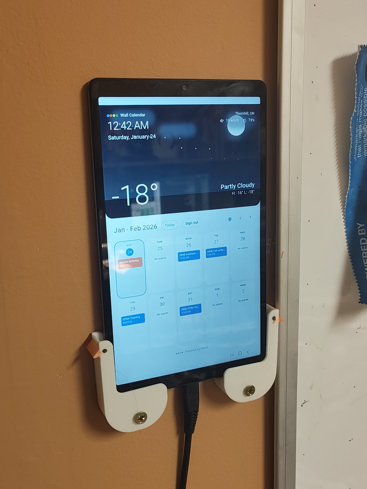

# Wall Calendar

A portrait-oriented, self-hosted calendar display for a wall-mounted tablet. It combines selected Google Calendars with local weather in an installable Next.js PWA.

<p align="center">
  
</p>

## Features

- View a navigable 10-day calendar at a glance.
- Connect Google Calendar and choose exactly which calendars to show.
- Keep each event's Google Calendar color, including all-day events.
- See current local weather conditions.
- Install the app in standalone mode on a portrait-oriented tablet.
- Display every date and time in the Toronto time zone.

## Getting started

### Prerequisites

- Node.js 18 or later
- A Google Cloud project with the Google Calendar API enabled
- An OpenWeather API key

### 1. Install dependencies

```bash
npm install
```

### 2. Configure Google Calendar

In the [Google Cloud Console](https://console.cloud.google.com/), create OAuth 2.0 credentials for a web application, enable the Google Calendar API, and add yourself as a test user. For local development, add this authorized redirect URI:

```
http://localhost:3000/api/auth/google/callback
```

### 3. Add local environment variables

Create `.env.local` in the project root:

```env
GOOGLE_CLIENT_ID=your_google_client_id
GOOGLE_CLIENT_SECRET=your_google_client_secret
GOOGLE_REDIRECT_URI=http://localhost:3000/api/auth/google/callback
NEXT_PUBLIC_BASE_URL=http://localhost:3000
OPENWEATHER_API_KEY=your_openweather_api_key
```

### 4. Start the app

```bash
npm run dev
```

Open [http://localhost:3000](http://localhost:3000), sign in with Google, and use the settings button to choose the calendars to display.

## Install on a tablet

- **iPad:** Open the app in Safari, tap **Share**, then choose **Add to Home Screen**.
- **Android:** Open the app in Chrome, open the browser menu, then choose **Install app** or **Add to Home screen**.

## Deploy

Deploy to Vercel or another Node.js-compatible host. Set the environment variables above with your production values, update `GOOGLE_REDIRECT_URI` and `NEXT_PUBLIC_BASE_URL` to your deployed URL, then add the production callback URL to your Google OAuth credentials.

For the full Vercel walkthrough, see [DEPLOYMENT.md](./DEPLOYMENT.md).

## TRMNL E-ink Display

The app serves an 800×480 black-and-white calendar image for a [TRMNL](https://trmnl.com) OG,
shown with TRMNL's free **Alias** plugin (the device downloads the image straight from this app).

```
GET /api/trmnl/image?key=<TRMNL_KEY>           # 1-bit PNG (all firmware)
GET /api/trmnl/image?key=<TRMNL_KEY>&bits=2    # 4-gray PNG (firmware 1.6+)
GET /api/trmnl/image?key=<TRMNL_KEY>&demo=1    # sample events, for previewing the layout
```

### Setup

1. **Pick a secret** and add it to Vercel as `TRMNL_KEY` (e.g. `openssl rand -hex 16`).
2. **Keep the Google token alive:** in Google Cloud Console → OAuth consent screen, set the
   publishing status to **In production**. In "Testing" mode, refresh tokens expire after 7 days
   and the display silently stops updating.
3. **Get a refresh token:** deploy, sign out of the wall calendar and sign back in with Google,
   then open `https://your-app.vercel.app/api/trmnl/setup?key=<TRMNL_KEY>`. Copy
   `GOOGLE_REFRESH_TOKEN` into Vercel's environment variables.
4. *(Optional)* Set `TRMNL_CALENDAR_IDS` to a comma-separated list of calendar IDs from the setup
   page. If unset, every calendar checked in Google Calendar is shown.
5. **Redeploy**, then open the image URL in a browser to check it.
6. **On trmnl.com:** add the **Alias** plugin, paste the image URL, and add it to your device's playlist.

| Variable | Required | Description |
|----------|----------|-------------|
| `TRMNL_KEY` | Yes | Shared secret for the `/api/trmnl/*` endpoints |
| `GOOGLE_REFRESH_TOKEN` | Yes | Lets the server read your calendar without a browser session |
| `TRMNL_CALENDAR_IDS` | No | Comma-separated calendar IDs to show |

## Commands

| Command | Description |
| --- | --- |
| `npm run dev` | Start the development server |
| `npm run build` | Create a production build |
| `npm start` | Run the production server |
| `npm run lint` | Run ESLint |

## Built with

Next.js, TypeScript, Tailwind CSS, shadcn/ui, Google Calendar API, OpenWeather API, and a web app manifest/service worker for PWA installation.

## License

Private project.
